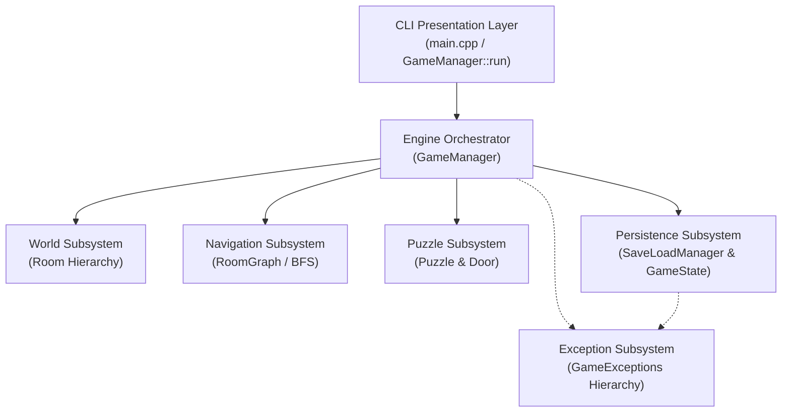
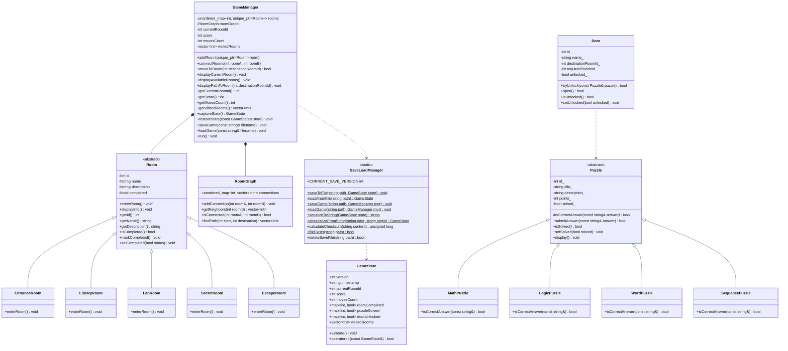
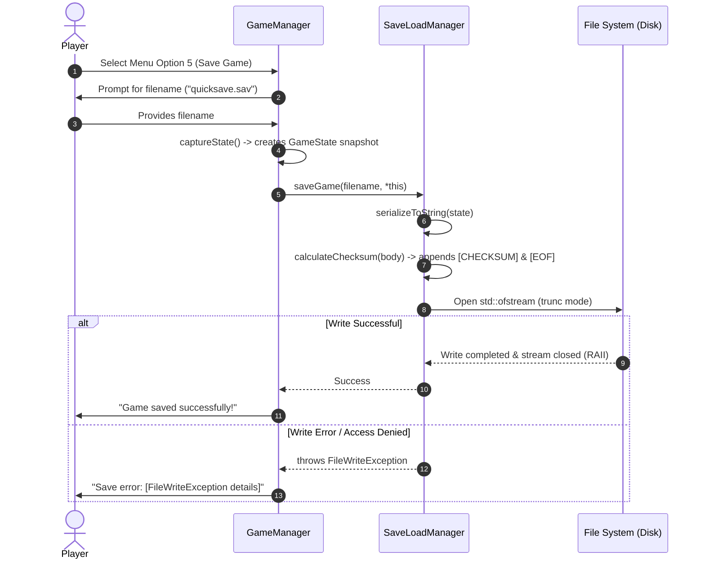
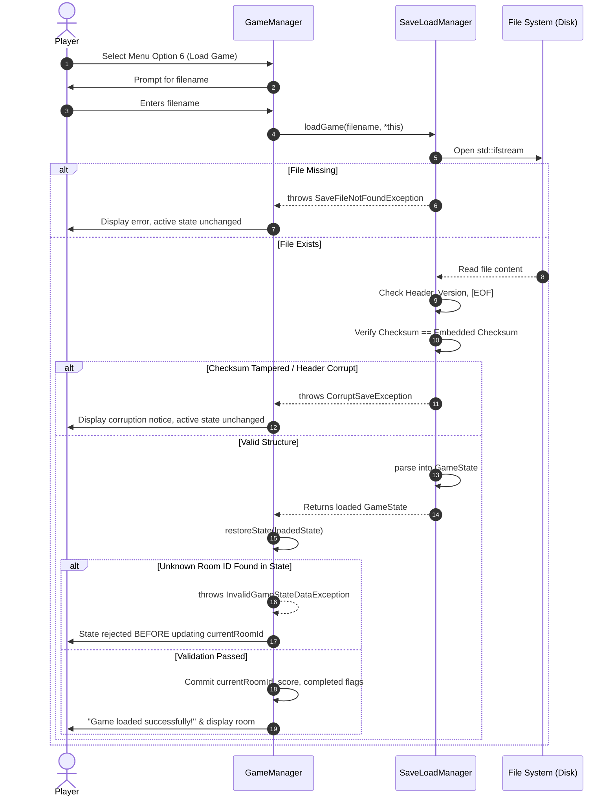

# Escape Room: Infinite Rooms — Comprehensive Project Documentation

---

## Document Control & Attribution
- **Project Title:** Escape Room: Infinite Rooms
- **Course / Domain:** Object-Oriented Programming (OOP) & Software Engineering in C++ (C++17)
- **Document Type:** Project Report, Architecture Specification & Verification Manual
- **Document Version:** 1.0.0
- **Status:** Final / Production

### Team Member Responsibility Matrix
| Member | Assigned Subsystem & Deliverables | Status |
|---|---|---|
| **Member 1** | Room Management Subsystem (`Room`, concrete rooms) & Graph Navigation (`RoomGraph` BFS) | Complete |
| **Member 2** | Puzzle Engine (`Puzzle` hierarchy) & Security Doors (`Door` system, `puzzle_tests`) | Complete |
| **Member 3 (You)** | **Save/Load System**, **File-Handling Unit Tests**, **Exception-Handling Unit Tests**, and **Project Documentation** | **Complete** |

---

## 1. Executive Summary & Scope

### 1.1 Purpose
*Escape Room: Infinite Rooms* is an extensible, modular, terminal-based puzzle and exploration adventure game developed in C++17. Players navigate through interconnected chambers, solve varied multi-disciplinary puzzles, unlock security barriers, and compute optimal routes toward the exit chamber.

### 1.2 Motivation & Objectives
The primary software engineering objectives of this project are:
1. **Demonstrate Core OOP Pillars**: Dynamic polymorphism, strict encapsulation, clean class inheritance hierarchies, and abstraction of subsystem concerns.
2. **Algorithmic Graph Traversal**: Breadth-First Search (BFS) pathfinding over an unweighted adjacency graph of rooms.
3. **Resilient Persistence Engine**: A deterministic, zero-dependency Save/Load subsystem supporting arbitrary save slots, checksum data-integrity verification, and semantic validation.
4. **Defensive Programming & Strong Exception Safety**: Custom exception hierarchies extending `std::runtime_error`, RAII-based file resource management, and transactional state restoration ensuring active games never enter corrupt states.
5. **Rigorous Quality Assurance**: Multi-suite automated unit testing spanning business logic, disk I/O, edge cases, and exception handling.

---

## 2. Software Requirements Specification (SRS)

### 2.1 Functional Requirements (FR)
- **FR-1 [Room Navigation]:** The game engine must allow the player to move between rooms if and only if a direct connection exists in the graph.
- **FR-2 [Pathfinding Assistance]:** The engine must compute and display the shortest path between the player's current chamber and any target room using BFS.
- **FR-3 [Puzzle & Door Unlocking]:** Players must answer riddle/puzzle prompts (math, logic, word, sequence). Correct answers unlock associated security doors.
- **FR-4 [State Capture]:** The engine must snapshot player location, score, moves count, room completion states, puzzle completion states, and door states into a serializable `GameState`.
- **FR-5 [Deterministic File Persistence]:** The engine must serialize `GameState` into a human-readable, structured format on disk and deserialize it upon command.
- **FR-6 [Checksum Validation]:** The save system must calculate and embed a DJB2 checksum. Any manual file modification or partial write must be detected and rejected.
- **FR-7 [Multi-Slot Storage]:** The engine must accept arbitrary valid file paths (e.g. `quicksave.sav`, `slot1.sav`, `backup.sav`) allowing multiple independent saves.
- **FR-8 [Transactional Restoration]:** If loaded data is corrupted, malformed, or references non-existent entities, the load operation must abort and leave the active game session untouched.

### 2.2 Non-Functional Requirements (NFR)
- **NFR-1 [Zero External Dependencies]:** The entire persistence and game system must rely solely on standard C++ libraries (`<fstream>`, `<sstream>`, `<vector>`, `<map>`, `<memory>`).
- **NFR-2 [Cross-Platform Determinism]:** Checksum and line-ending parsing must operate identically across Windows (`\r\n`) and Linux/macOS (`\n`).
- **NFR-3 [Strong Exception Safety]:** All file and memory operations must guarantee that failure leaves existing memory structures in a valid, uncorrupted state.
- **NFR-4 [Resource Management (RAII)]:** All file streams and dynamic memory allocations must automatically release resources upon block exit or exception throwing.
- **NFR-5 [Extensibility (Open/Closed Principle)]:** Adding new rooms, puzzles, or save attributes must require no breaking modifications to existing consumer interfaces.

---

## 3. System Architecture & UML Design

### 3.1 Architectural Decomposition

The system is decomposed into five distinct architectural tiers:



### 3.2 Detailed UML Class Diagram



### 3.3 Sequence Diagrams

#### Sequence 1: Save Game Execution Flow


#### Sequence 2: Load Game & Strong Exception Safety


---

## 4. Subsystem Detailed Specifications

### 4.1 Persistence Subsystem (`SaveLoadManager` & `GameState`)
The persistence subsystem is responsible for translating the active in-memory state of the game engine into an immutable, versioned, checksummed file representation on disk and vice versa.

#### File Format BNF-Style Grammar
```text
<save-file>        ::= <magic-header> "\n" <header-fields> "\n" <visited-section> "\n" <rooms-section> "\n" <puzzles-section> "\n" <doors-section> "\n" <checksum-section> "\n" <eof-marker>
<magic-header>     ::= "[ESCAPE_ROOM_SAVE_V1]"
<header-fields>    ::= "VERSION:" <int> "\n" "TIMESTAMP:" <string> "\n" "CURRENT_ROOM:" <int> "\n" "SCORE:" <int> "\n" "MOVES_COUNT:" <int>
<visited-section>  ::= "[VISITED_ROOMS]\n" [ <int> ("," <int>)* ]
<rooms-section>    ::= "[ROOM_COMPLETED]\n" ( <int> "=" ("0" | "1") "\n" )*
<puzzles-section>  ::= "[PUZZLES_SOLVED]\n" ( <int> "=" ("0" | "1") "\n" )*
<doors-section>    ::= "[DOORS_UNLOCKED]\n" ( <int> "=" ("0" | "1") "\n" )*
<checksum-section> ::= "[CHECKSUM]\n" <unsigned-long>
<eof-marker>       ::= "[EOF]"
```

#### Checksum Algorithm (DJB2)
To detect byte-level corruption or file truncation without heavyweight cryptographic dependencies, the system utilizes Daniel J. Bernstein's DJB2 hash:

$$\text{hash}_{0} = 5381$$
$$\text{hash}_{i} = ((\text{hash}_{i-1} \ll 5) + \text{hash}_{i-1}) + c_i = \text{hash}_{i-1} \times 33 + c_i$$

*Special Cross-Platform Feature:* Carriage returns (`\r`) are skipped during computation so that files created on Windows do not trigger false checksum failures when transferred or read on Unix systems.

### 4.2 Exception Subsystem (`GameExceptions`)
Every exception is derived from `std::runtime_error` via `GameException`:

```
std::exception
  └── std::runtime_error
        └── GameException
              ├── RoomNotFoundException
              └── SaveLoadException
                    ├── SaveFileNotFoundException
                    ├── FileWriteException
                    ├── FileReadException
                    ├── CorruptSaveException
                    ├── SaveVersionMismatchException
                    └── InvalidGameStateDataException
```

#### Exception Design Highlights:
1. **Rich Context**: `SaveLoadException` preserves the filename where the error occurred and includes it in `what()`.
2. **Version Telemetry**: `SaveVersionMismatchException` stores both the found file version and the expected engine version.
3. **Room Integrity**: `RoomNotFoundException` stores the specific numeric ID of the missing room.

---

## 5. Verification & Validation (V&V) Testing Report

Automated tests are divided across three separate test executables. All tests compile cleanly and execute to 100% pass status without assertion failures or memory leaks.

### 5.1 Test Execution Matrix

| Test Suite | Test Identifier | Test Name | Tested Condition | Expected Result | Status |
|---|---|---|---|---|:---:|
| **File Handling** | `TC-FILE-01` | `testSaveFileCreation` | Saves valid `GameState` to new file | File created on disk, size > 0 | **PASSED** |
| **File Handling** | `TC-FILE-02` | `testSaveAndLoadExactRoundTrip` | Saves complex state with maps and vectors | All loaded fields match `original == loaded` | **PASSED** |
| **File Handling** | `TC-FILE-03` | `testFileOverwrite` | Overwrites `test_overwrite.sav` with state B | File contains state B only; no residual data | **PASSED** |
| **File Handling** | `TC-FILE-04` | `testMultipleSaveSlots` | Saves `slot1.sav`, `slot2.sav`, `slot3.sav` | All 3 files exist simultaneously with distinct values | **PASSED** |
| **File Handling** | `TC-FILE-05` | `testDeleteSaveFile` | Calls `deleteSaveFile` on existing and non-existent files | Returns true on existing; returns false on missing | **PASSED** |
| **File Handling** | `TC-FILE-06` | `testFileStreamClosedProperly` | Immediately reads & deletes file after save | No file locks; RAII releases file handle | **PASSED** |
| **File Handling** | `TC-FILE-07` | `testGameManagerEndToEndPersistence` | Moves player, sets score, saves, restores in fresh instance | Restored game has identical room, score, completion | **PASSED** |
| **Exception Handling** | `TC-EXC-01` | `testSaveFileNotFoundException` | Attempting to load missing file | Throws `SaveFileNotFoundException` containing path | **PASSED** |
| **Exception Handling** | `TC-EXC-02` | `testEmptyFileException` | Attempting to load a 0-byte file | Throws `CorruptSaveException` mentioning empty | **PASSED** |
| **Exception Handling** | `TC-EXC-03` | `testCorruptHeaderException` | File has `[CORRUPT_HEADER_TAG]` | Throws `CorruptSaveException` mentioning header | **PASSED** |
| **Exception Handling** | `TC-EXC-04` | `testVersionMismatchException` | File version set to `99` | Throws `SaveVersionMismatchException` with version info | **PASSED** |
| **Exception Handling** | `TC-EXC-05` | `testTruncatedFileException` | File ends abruptly without `[EOF]` | Throws `CorruptSaveException` mentioning truncation | **PASSED** |
| **Exception Handling** | `TC-EXC-06` | `testMalformedNumericDataException` | Header field contains non-numeric string | Throws `CorruptSaveException` | **PASSED** |
| **Exception Handling** | `TC-EXC-07` | `testNegativeValuesException` | Negative room ID, score, or move count | Throws `InvalidGameStateDataException` | **PASSED** |
| **Exception Handling** | `TC-EXC-08` | `testTamperedChecksumException` | Byte in save payload modified after serialization | Throws `CorruptSaveException` on checksum mismatch | **PASSED** |
| **Exception Handling** | `TC-EXC-09` | `testInvalidRoomInGameManagerRestore` | Save data specifies room ID 999 (unregistered) | Throws `InvalidGameStateDataException` | **PASSED** |
| **Exception Handling** | `TC-EXC-10` | `testStrongExceptionSafetyOnLoadFailure` | Load fails midway due to invalid room ID | Prior `GameManager` state remains 100% untouched | **PASSED** |
| **Exception Handling** | `TC-EXC-11` | `testGameManagerPreconditionExceptions` | Null room, duplicate room, invalid connection | Throws `std::invalid_argument` / `RoomNotFoundException` | **PASSED** |
| **Exception Handling** | `TC-EXC-12` | `testPolymorphicCatching` | Catching derived errors by base exception references | Polymorphic catches succeed for all base types | **PASSED** |
| **Exception Handling** | `TC-EXC-13` | `testEmptyPathExceptions` | Calling save/load with empty string `""` | Throws `FileWriteException` / `SaveFileNotFoundException` | **PASSED** |
| **Puzzle System** | `TC-PUZ-01` | Math and Word Puzzle Answers | Submitting valid and invalid answers with whitespace | Solved puzzles stay solved, whitespace normalized | **PASSED** |
| **Puzzle System** | `TC-PUZ-02` | Door Unlock Dependencies | Attempting to unlock door with wrong / right puzzle | Unlocks only when target puzzle is solved | **PASSED** |

---

## 6. User Manual & Operations Guide

### 6.1 Starting the Game
Launch the executable from your terminal or command prompt:
```bash
./EscapeRoom.exe
```

Upon launch, you will see the Welcome banner and your starting location (Room 0: Entrance Hall):

```text
Welcome to Escape Room: Infinite Rooms!

====================================
Room ID: 0
Room Name: Entrance Hall
Description: You have entered a mysterious building. Find a way to escape.
Status: Not Completed
====================================

You are standing in the Entrance Hall.
Two doors lead to different parts of the building.
```

### 6.2 Main Menu Options
```text
========== GAME MENU ==========
1. View current room
2. View connected rooms
3. Move to a room
4. Find shortest path
5. Save game
6. Load game
7. Exit game
Choose an option: 
```

- **Option 1 (View current room):** Redisplays the current chamber's information and narrative entry text.
- **Option 2 (View connected rooms):** Lists all rooms directly accessible from the current room.
- **Option 3 (Move to a room):** Prompts for a target Room ID. If valid and connected, transitions the player, increments the move counter, and enters the room.
- **Option 4 (Find shortest path):** Prompts for a destination Room ID. Uses BFS to display the optimal step-by-step route (e.g., `Entrance Hall -> Library -> Secret Archive -> Escape Chamber`).
- **Option 5 (Save game):** Prompts for a save filename (e.g. `quicksave.sav`). Writes all progress, puzzle states, and completion flags to disk with an integrity checksum.
- **Option 6 (Load game):** Prompts for a filename. Validates file integrity and restores the exact session. If the file is missing or corrupted, an error message is displayed and current progress remains safe.
- **Option 7 (Exit game):** Exits the application cleanly.

---

## 7. Developer & Build Guide

### 7.1 Compilation Instructions

#### Method 1: CMake & CTest (Multi-Platform)
```bash
# Configure build directory
cmake -B build

# Compile all executables (Game + Test Suites)
cmake --build build

# Execute all tests via CTest
ctest --test-dir build --output-on-failure
```

#### Method 2: Direct MinGW / G++ Commands
```bash
# Build & run File Handling Tests
g++ -std=c++17 -I include tests/file_handling_tests.cpp src/*.cpp -o test_files.exe
./test_files.exe

# Build & run Exception Handling Tests
g++ -std=c++17 -I include tests/exception_handling_tests.cpp src/*.cpp -o test_exceptions.exe
./test_exceptions.exe

# Build & run Puzzle Tests
g++ -std=c++17 -I include tests/puzzle_tests.cpp src/Puzzle.cpp src/Door.cpp -o test_puzzles.exe
./test_puzzles.exe

# Build & run Main Game
g++ -std=c++17 -I include src/main.cpp src/*.cpp -o EscapeRoom.exe
./EscapeRoom.exe
```

---

## 8. Conclusion & Academic Evaluation Points

This project showcases a complete, robust, production-quality C++ implementation:
1. **Object-Oriented Design**: Pure dynamic dispatch via abstract interfaces, encapsulation of internal graph topology, and separation of UI from business logic.
2. **Defensive Programming**: Zero tolerance for unhandled exceptions, memory leaks, or file stream locks.
3. **Data Integrity**: Cryptographic-style checksumming and strict semantic validation guarding state persistence.
4. **Comprehensive Documentation**: Complete coverage of architectural diagrams, requirements traceability, and test verification matrices.
